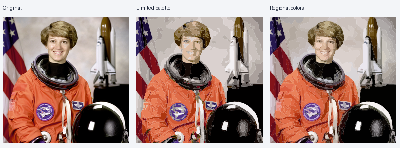

# Vectorize

[](https://github.com/juangrukat/Vectorize/actions/workflows/ci.yml)
[](LICENSE)

**Convert artwork and photographs into editable SVGs.** A CPU-native engine with
a browser upload/preview interface, REST API, local CLI, and Docker deployment.



- Real filled paths and cubic curves, including transparency and holes.
- Photo **Auto colors** fits local region colors; fixed palettes create a more
  posterized style.
- Bounded background workers, enforceable timeouts, and persistent job results.
- CPU-only: no GPU or external conversion API required.

## Start with Docker

```sh
git clone https://github.com/juangrukat/Vectorize.git
cd Vectorize
docker compose up --build -d
```

Open **http://localhost:8000/** for the browser tester, or
**http://localhost:8000/docs** for interactive API documentation.

Select an image, choose Artwork or Photograph, convert, and download the SVG.
For photographs, start with **Auto colors** and **Detail 0.8**.

Compose binds localhost port 8000 and stores jobs in the named volume.
Stop with `docker compose down`; add `-v` only when you want to remove stored
jobs too. Change the host port mapping if port 8000 is occupied.

### Prebuilt images

[GitHub Releases](https://github.com/juangrukat/Vectorize/releases/latest) contain
native Linux AMD64 and ARM64 Docker archives with SHA-256 checksum files.

```sh
# Use the arm64 asset for ARM servers or Apple Silicon.
curl -fL -o Vectorize-linux-amd64.tar.gz \
  https://github.com/juangrukat/Vectorize/releases/latest/download/Vectorize-linux-amd64.tar.gz
docker load -i Vectorize-linux-amd64.tar.gz
docker run -d --name vectorize \
  -p 127.0.0.1:8000:8000 -v vectorize-data:/data vectorize:0.2.0
```

## API

```sh
curl --fail -F image=@examples/artwork.png \
  -F preset=artwork -F colors=4 -F detail=0.8 \
  http://localhost:8000/v1/vectorize -o artwork.svg

curl --fail -F image=@examples/photo.png \
  -F preset=photo -F colors=0 -F detail=0.8 \
  http://localhost:8000/v1/vectorize -o photo.svg
```

| Field | Default | Meaning |
|---|---|---|
| `image` | Required | PNG, JPEG, or WebP |
| `preset` | `artwork` | `artwork` or `photo` |
| `colors` | `0` | Auto; photo mode uses independent regional colors. 2–64 requests a limited palette |
| `detail` | `0.7` | 0–1; adjusts segmentation, cleanup, and curve tolerance |
| `background` | `transparent` | Preserve alpha, or composite on `white` or `#RRGGBB` |

SVG dimensions retain the original image size. Working resolution is bounded.
Synchronous responses include measurements in `X-Vector-Metadata`.

### Background jobs

```sh
curl --fail -F image=@examples/photo.png -F preset=photo \
  http://localhost:8000/v1/jobs
```

The HTTP 202 response includes `id`, `status_url`, and `result_url`.
Poll the status URL; when status is `complete`, download the result URL.

| Endpoint | Purpose |
|---|---|
| `GET /` | Browser tester |
| `POST /v1/vectorize` | Wait and return SVG |
| `POST /v1/jobs` | Queue conversion |
| `GET /v1/jobs/{id}` | Status and measurements |
| `GET /v1/jobs/{id}/result` | Download SVG |
| `DELETE /v1/jobs/{id}` | Remove a terminal job |
| `GET /health`, `GET /ready` | Liveness and worker readiness |

Completed results survive restart; interrupted jobs are requeued. Inputs are
removed after completion/failure. Terminal results expire after retention, with
history capped at 256 jobs. Prefer background jobs behind short-timeout proxies.

## Configuration

| Environment variable | Default |
|---|---:|
| `VECTOR_WORKERS` | 2 |
| `VECTOR_DATA_DIR` | `/data` in Docker |
| `VECTOR_MAX_UPLOAD_BYTES` | 16777216 |
| `VECTOR_MAX_PIXELS` | 24000000 |
| `VECTOR_MAX_DIMENSION` | 512 |
| `VECTOR_MAX_REGIONS` | 2000; maximum 4096 |
| `VECTOR_MAX_ITERATIONS` | 30 |
| `VECTOR_MAX_PENDING_JOBS` | 32 including running jobs |
| `VECTOR_JOB_TIMEOUT_SECONDS` | 120 |
| `VECTOR_RESULT_TTL_SECONDS` | 86400 |
| `VECTOR_API_KEY` | Unset for local testing |

Higher resolution/region limits retain more detail at greater CPU/memory cost.
Compose limits the service to two CPUs and 2 GiB; the image runs as UID 10001.

For network deployment, use a TLS reverse proxy and set `VECTOR_API_KEY` in
`.env` (copy `.env.example`). Send the key in `X-API-Key`.
Health endpoints remain unauthenticated. Uploaded images stay on your server.

Use **one API process per data volume**. This is a local SQLite-backed queue,
not a distributed multi-host scheduler.

Errors include 401 for authentication, 413 for oversized upload, 422 for invalid
image/options or excessive complexity, 429 for a full queue, 409 for an unfinished
download, and 504 for timeout.

## Local CLI and development

Requires Python **3.12+** and a C++17 compiler.

```sh
python -m venv .venv
. .venv/bin/activate
pip install -e '.[dev]'
vectorize examples/photo.png photo.svg --preset photo --colors 0 --detail .8
vectorize-server
```

Local storage defaults to `work/vector-data` relative to the current directory.

```sh
pytest --cov=vector_server --cov-fail-under=90
mypy --strict src
ruff check src tests setup.py
black --check src tests setup.py
```

CI tests Python 3.12/3.13. Release workflows build and smoke-test native AMD64/ARM64
images and attach them to GitHub Releases. See [CONTRIBUTING.md](CONTRIBUTING.md).

## Engine and tradeoffs

FastAPI/Pydantic serves requests; NumPy/SciPy handles numerical operations.
C++17/pybind11 kernels implement exact polygon-area rendering and analytic
gradients, connected Ward merging, and topology-preserving pixel reassignment.
Shared interfaces reuse cubic controls. Photographs use selective 5×5 denoising
and independently fitted region colors.

Initialization, merge scheduling, and corner heuristics are independently chosen.
Exact Vector Magic equivalence is not claimed. Solid-color regions approximate
gradients; some renderers can show antialias seams. Working-resolution limits
and region caps affect output detail.

On the included photo fixture, regional colors reduced rendered RGB RMSE from
0.0520 to 0.0337—about 35% less error than 24 colors. This is one measured example,
not a universal quality guarantee.

## Examples and credits

[Artwork SVG](examples/artwork.svg) ·
[Photo SVG](examples/photo-regional.svg) ·
[Comparison measurements](examples/photo-improvement-metrics.json)

The artwork is an original synthetic fixture. The NASA Eileen Collins photograph
is distributed by scikit-image and documented as public domain.
[Attribution](https://scikit-image.org/docs/stable/api/skimage.data#skimage.data.astronaut).

Filtering is independently translated from recovered ImageMagick EnhanceImage
mathematics. Third-party libraries retain their licenses. [MIT License](LICENSE).
